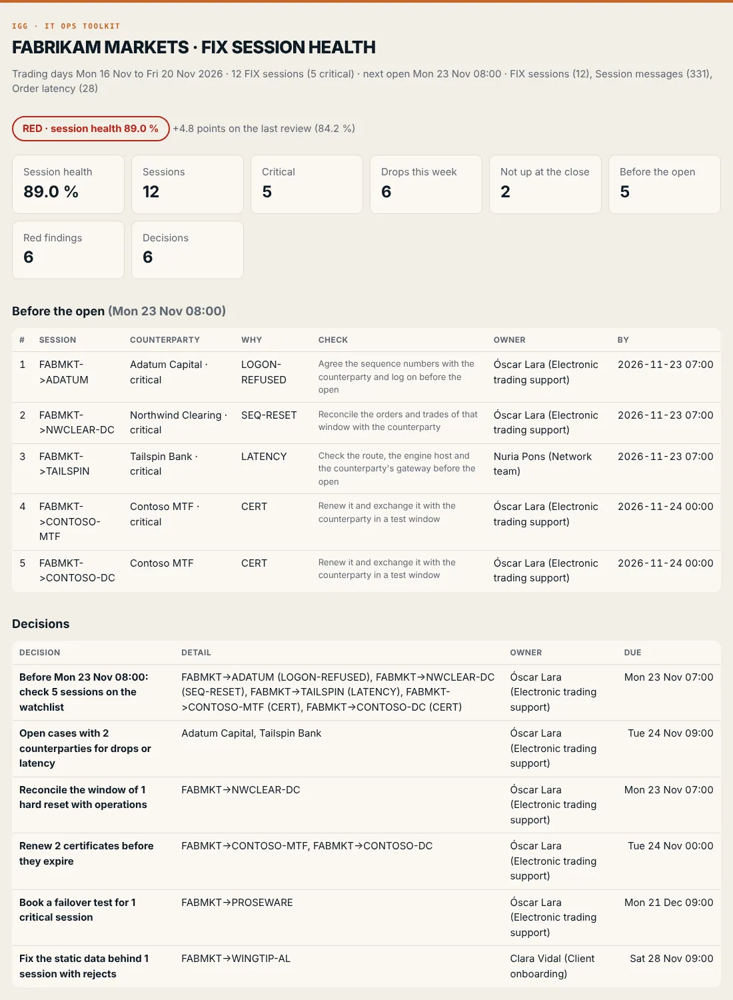

# FIX Session Health

The question for electronic trading support on Friday evening, or an hour before Monday's open: how did every FIX session behave this week, and which ones have to be looked at before the market opens? From the session list, the session-level messages in the FIX engine logs (logons, logouts, test requests, resend requests, sequence resets and rejects) and the daily order latency, it puts together:

- **Stability:** drops without a logout, how many in market hours, logons refused at the close and sessions that went silent.
- **Sequence numbers:** gaps that needed a resend and sequence resets without gap fill, where messages may never have been resent.
- **Heartbeats, rejects and latency:** test requests sent because the counterparty's heartbeats stopped, session and business rejects, heartbeat intervals that do not match the configuration, and order latency against a limit and against the session's own baseline.
- **Certificates and failover:** TLS certificates about to expire and critical sessions whose failover has not been tested.

Every finding has an owner and a due time, every session and counterparty gets a **health score**, the sessions to check come out as a **watchlist before the open**, the choices (check the watchlist, open cases with counterparties, reconcile a reset, renew certificates, book a failover test, fix static data) become **decisions**, and `preopen-pack.md` is the page for the desk.

Python 3.10+, standard library only. It runs with fictional demo data out of the box. A read-only PowerShell script takes the session-level messages from QuickFIX/J or QuickFIX/n style logs.

It sits next to [59-market-data-entitlement-review](https://github.com/inigogonzalezgarcia/59-market-data-entitlement-review), the other half of a trading floor's connectivity, and [36-major-incident-command-kit](https://github.com/inigogonzalezgarcia/36-major-incident-command-kit), for when a session is down in market hours.



## Why

FIX sessions fail in small ways long before they fail in a big one, and the evidence is spread over one log per session:

- an order session drops five times in a week, four of them in market hours, and reconnects on its own each time;
- a logon at ten to ten on Friday night is refused for sequence numbers, and nobody sees it until Monday's open;
- a drop copy receives a sequence reset without gap fill, so 128 messages were never resent;
- test requests go out every morning around the open because a market data feed stops sending heartbeats;
- the order round trip of a critical session goes from 4 to 38 ms on the last day of the week;
- a TLS certificate expires on Thursday and a critical session's failover has never been tried.

The review reads them together against the desk's thresholds and turns them into a watchlist for the open, a short list of fixes and decisions. The policy is in `settings.json`; the rules are in `fixhealth/checks.py`.

## What it checks

| Area | Code | Finding | Severity |
|---|---|---|---|
| Stability | DROPS | Session ended without a logout (disconnect logged, or a new logon while up) | AMBER (RED for critical with 3+ in market hours) |
| Stability | LOGON-REFUSED, SILENT | Last logon refused and not back; no logon on the last trading day | RED; AMBER (RED for critical) |
| Sequence numbers | SEQ-GAPS, SEQ-RESET | Resend requests above the threshold; sequence reset without gap fill | AMBER; RED for critical and drop copies |
| Heartbeats, rejects and latency | HB-MISSED, REJECTS, HB-MISMATCH | Test requests sent, rejects above the threshold, heartbeat interval different from the configuration | AMBER |
| Heartbeats, rejects and latency | LATENCY | Last day's p99 above the limit and twice the session's baseline | AMBER (RED for critical) |
| Certificates and failover | CERT, FAILOVER | TLS certificate expiring in 30 days (7 red); critical session with no tested failover | AMBER or RED; AMBER |

Market hours, thresholds and latency limits are the desk's own policy in `settings.json`; the defaults are an example. [docs/data-format.md](docs/data-format.md) has every rule, column, FIX tag, setting and how the score is calculated.

## Outputs

| File | What |
|---|---|
| `report.html` | Score with its trend, tiles, the watchlist before the open, decisions, every finding by area, sessions with their week, day by day and counterparties |
| `preopen-pack.md` | One page for the desk: result, the watchlist, headlines, decisions, sessions and sources |
| `sessions.csv`, `daily.csv` | One row per session (state, drops, resends, hard resets, test requests, rejects, p99, score, findings); one row per session and day |
| `watchlist.csv`, `counterparties.csv` | What to check before the open, in order, with owner and time; score per counterparty |
| `findings.csv`, `actions.csv` | Every finding with severity, owner and due time; the same as actions with a reference and a done column |

## Try it

```bash
git clone https://github.com/inigogonzalezgarcia/60-fix-session-health.git
cd 60-fix-session-health
python -m fixhealth demo
```

Open `output/report.html` and `output/preopen-pack.md`.

### The demo data

The demo is a made-up broker, Fabrikam Markets, with its electronic trading desk in Madrid: 12 FIX sessions (5 critical) with 10 counterparties for orders, drop copies, market data and allocations. The review runs on Saturday 21 November 2026 over the trading week of 16-20 November, ahead of Monday's open.

Everything is fictional: names, CompIDs, hosts, figures and times. The problems are placed on purpose among sessions that are fine:

- **Stability:** Tailspin Bank's order session drops five times (four in market hours); Adatum Capital's logon at 21:58 on Friday is refused with "MsgSeqNum too low, expecting 4812 but received 1"; Relecloud's RFQ session has not logged on since Wednesday.
- **Sequence numbers:** Northwind Clearing's drop copy gets a sequence reset without gap fill on Wednesday at 14:12, from 18322 to 18450; Tailspin needs six resends after its drops.
- **Traffic:** Litware's market data needs 14 test requests around the open; Wingtip Prime rejects 22 allocations for an unknown account; Woodgrove's logons carry a 60-second heartbeat against 30 configured; Tailspin's p99 jumps from about 4 ms to 38 ms on Friday.
- **Resilience:** the Contoso MTF certificate expires on Thursday 26 November; Proseware's failover has never been tested.

The result: **RED**; session health 89 % (4.8 points up on the last review); 6 drops, 2 sessions not up at the last close, 5 sessions on the watchlist before Monday 08:00; 6 red and 8 amber findings and 6 decisions.

## Use it with your own data

1. Export the session-level messages (read-only):
   ```powershell
   .\scripts\Export-FixSessionEvents.ps1 -LogFolder D:\fixgw\log -Days 7 -OutputFolder .\data
   ```
   It reads the messages and event logs of each session, keeps logons, logouts, test requests, resend requests, sequence resets, rejects and disconnects with their FIX tags, and changes nothing. FIX times are UTC: set the market hours in UTC too, or convert the column.
2. Add the rest:
   - `sessions.csv` from the engine configuration: counterparty, purpose, critical, heartbeat interval, hosts, last failover test and certificate expiry;
   - `latency.csv` from the engine or the monitoring, if you have it;
   - `data/settings.json`: market hours, thresholds and owners ([docs/data-format.md](docs/data-format.md)).
3. Build the outputs:
   ```bash
   python -m fixhealth review data/
   ```

[docs/preopen-runbook.md](docs/preopen-runbook.md) has the weekly cycle, how to read the result (what is not up, whether messages can have been lost, whether it is stable, what will break on its own), how to change sequence numbers, certificates and failover without surprises and what to keep as evidence.

The exports contain CompIDs, hosts, counterparties and account references from rejects. Keep them inside your organisation:

- real files at the top level (`sessions*.csv`, `events*.csv`, `latency*.csv`, `settings.json`, `data/`, `logs/`) and the `output/` folder are excluded from Git by `.gitignore`;
- only the fictional files in `sample_data/` are committed.

## Tests

```bash
pip install -r requirements-dev.txt
python -m pytest -q
```

GitHub Actions runs them on Python 3.10 and 3.12 on every push, checks that the committed sample data is what the simulator writes, and keeps the demo report and a screenshot as build artifacts.

14 tests: the parsers and the trading calendar; a quiet week with no findings; drops logged and inferred, in market hours; a logon refused at the close at the top of the watchlist; a silent session; gaps and a hard reset; missed heartbeats, rejects and a heartbeat mismatch; latency against the limit and the session's baseline; certificates and failover; a session missing from the list; other column names and semicolons; missing files; the demo end to end; and a deterministic demo.

## Next steps

- Run it on Friday after the close and on Monday before 06:30, and keep the score as `previous_score`.
- Read the engine logs straight from the gateways on a schedule, and the latency from the monitoring.
- Add the counterparty's own maintenance windows so planned logouts are not counted.
- Send the watchlist to the desk's chat an hour before the open.

## Background

Built from my work keeping trading floors connected:

- FIX and electronic trading connectivity with counterparties;
- LSEG RTDS / TREP and Bloomberg B-PIPE / Server API;
- monitoring and alerting, major incident response and post-mortems;
- network operations (Cisco), vendor management and PowerShell automation.

Written from scratch with fictional data; no employer data, systems or exports are used.

## Customisation and contact

Want this adapted to your environment? For example:

- your engine and its logs: QuickFIX, a commercial FIX engine, an order management system;
- your sessions, counterparties and market hours;
- latency from your monitoring;
- the watchlist in your desk's chat or ticketing tool.

Get in touch:

- Website (contact form): [inigogonzalezgarcia.github.io](https://inigogonzalezgarcia.github.io/about.html#contacto)
- LinkedIn: [linkedin.com/in/igonzalez93](https://www.linkedin.com/in/igonzalez93)

## License

MIT
